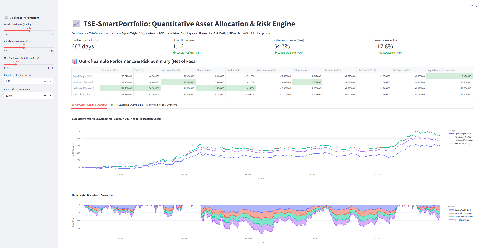

# 📈 TSE-SmartPortfolio: Quantitative Asset Allocation & Risk Engine

An end-to-end quantitative portfolio optimization and out-of-sample backtesting framework built for the **Tehran Stock Exchange (TSE)**. This engine compares classical and modern asset allocation models—**Equal-Weight (1/N)**, **Markowitz Mean-Variance (MVO)**, **Ledoit-Wolf Covariance Shrinkage**, and **Hierarchical Risk Parity (HRP)**—using walk-forward validation net of real-world transaction costs.



---

## 🎯 Key Quantitative & Engineering Highlights

* **Direct Market Data Pipeline (`src/data_loader.py`):** Fetches historical trading data directly from `cdn.tsetmc.com` REST APIs, handles trading halts via forward-filling, and computes dividend/capital-increase adjusted closing prices (`priceYesterday / pClosing`).
* **From-Scratch HRP Implementation (`src/optimizers.py`):** Implements Marcos López de Prado’s **Hierarchical Risk Parity** using `NumPy` and `SciPy` across its three core stages: hierarchical tree clustering, covariance matrix quasi-diagonalization, and recursive bisection.
* **Leak-Free Walk-Forward Backtester (`src/backtester.py`):** Simulates quarterly rebalancing (`60` trading days) using a rolling `242`-day (1 TSE trading year) lookback window, accounting for daily **weight drift** and round-trip brokerage fees (`1.25%`).
* **Tail-Risk & Monte Carlo Analytics (`src/risk_metrics.py`):** Evaluates portfolios across Sharpe, Sortino, Calmar, Max Drawdown, Historical VaR/CVaR (95%), and 10,000-path Monte Carlo CVaR.
* **Interactive Analytics Dashboard (`app.py`):** Built with **Streamlit** and **Plotly** for dynamic parameter stress-testing, dendrogram inspection, and weight evolution tracking.

---

## 📊 Empirical Out-of-Sample Results (Net of Fees)

Tested across a 12-asset multi-sector TSE universe (Metals, Petrochemicals, Refining, Automotive, Banking, Pharma, Food, and Gold ETF) over **667 out-of-sample trading days**:

| Strategy | Total Return | CAGR | Ann. Volatility | Sharpe Ratio | Sortino Ratio | Max Drawdown | Hist CVaR (95%) | Avg Turnover |
| :--- | :---: | :---: | :---: | :---: | :---: | :---: | :---: | :---: |
| **Equal-Weight (1/N)** | 153.07% | 40.06% | 20.46% | 0.466 | 0.511 | -21.69% | -2.67% | 9.49% |
| **Markowitz (Min-Var)** | 231.45% | 54.46% | **16.17%** | 1.148 | 1.411 | **-17.81%** | **-1.90%** | 28.73% |
| **Ledoit-Wolf (Min-Var)** | **232.73%** | **54.68%** | 16.18% | **1.156** | **1.415** | -18.33% | **-1.90%** | 28.83% |
| **HRP (Hierarchical)** | 192.12% | 47.54% | 17.17% | 0.823 | 0.965 | -18.76% | -2.14% | 26.73% |

### Key Takeaways
1. **Covariance Shrinkage Advantage:** `Ledoit-Wolf` achieved the highest risk-adjusted return (**Sharpe: 1.156**, **CAGR: 54.68%**), mitigating estimation error in noisy emerging-market return series.
2. **Downside Protection:** Both variance-minimizing models and `HRP` reduced annualized volatility by **3.3%–4.3%** and cushioned peak-to-trough drawdowns compared to the equal-weighted benchmark.
3. **Graph-Based Diversification:** `HRP` delivered **+39% higher cumulative return** than `1/N` while maintaining lower rebalance turnover than unconstrained mean-variance optimization.

---

## 🏗️ Project Structure

```text
TSE-SmartPortfolio/
├── assets/                 # Dashboard screenshots for documentation
├── data/                   # Cached adjusted price dataset (tse_prices.csv)
├── src/
│   ├── data_loader.py      # TSETMC API client & price adjustment logic
│   ├── optimizers.py       # 1/N, Markowitz, Ledoit-Wolf, and HRP algorithms
│   ├── backtester.py       # Walk-forward engine with drift & transaction fees
│   └── risk_metrics.py     # Sharpe, Sortino, Drawdown, Historical & MC CVaR
├── tests/
│   └── test_optimizers.py  # Unit tests verifying portfolio constraints
├── app.py                  # Interactive Streamlit + Plotly web application
├── pyproject.toml          # Pytest configuration
└── requirements.txt        # Project dependencies